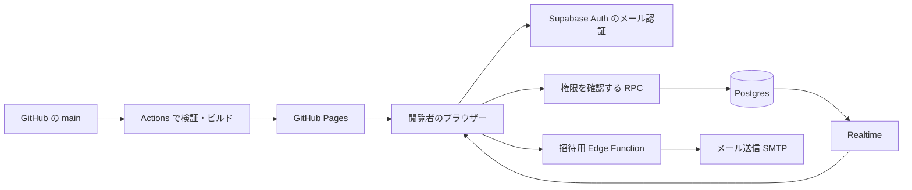

# michi の設計

## 目的とデザイン

仕事の案件やチーム活動について、「今週どこまで進んだか」「次に何をするか」「困っていることは何か」を招待した相手に伝えます。作業を管理する本人と、状況を知りたい閲覧者の両方に使いやすい画面を目指します。公式の作例は `public/references.html` に画像・出典・取り入れる点をまとめています。

| 作例 | 取り入れる点 |
| --- | --- |
| Linear | 成果・課題・次の行動を短い報告としてまとめる |
| Harvest | 案件ごとの予定工数と実績工数を並べる |
| Asana | 全体の状態から個々の案件へ進む |
| Basecamp | 数値だけで伝わりにくい不確実性を報告に残す |
| Notion | タスクと説明・メモを同じ場所で扱う |
| GitHub Projects | 状態別のボードと今後の予定を切り替える |

主に Linear と Harvest の考え方を参考にしました。背景は淡いグレー、内容は白いパネル、主操作は深い緑です。色は状態の見分けを助ける範囲に抑え、同じ意味を文字でも表示します。スマートフォンではサイドバーがメニューに切り替わります。

## GitHub と Supabase の役割

[GitHub Pages](https://docs.github.com/en/pages/getting-started-with-github-pages/what-is-github-pages) は静的な HTML・CSS・JavaScript を配信するサービスです。コードの更新を公開する用途に使い、閲覧者の認証、日々の保存、更新通知は Supabase に任せます。記録を変更するたびに GitHub にコミットする必要はありません。

進捗を保存すると、ログインしている招待者の画面が通知を受けて最新データを読み直します。[Supabase Realtime](https://supabase.com/docs/guides/realtime/postgres-changes)

## 権限とデータ

`app_settings` に設定したメールアドレスの本人だけが、最初のワークスペースを作れます。メールアドレスはデータベースだけに設定し、公開ソースには記載しません。

`workspaces` はオーナーと文書・リビジョンを保持します。`workspace_members` は招待先のメールアドレスを保持します。いずれも [Row Level Security](https://supabase.com/docs/guides/database/postgres/row-level-security) を有効にしています。

| 操作 | オーナー | 招待済み閲覧者 | その他・未ログイン |
| --- | --- | --- | --- |
| 実データを読む | 可 | 可 | 不可 |
| 作成・更新 | 可 | 不可 | 不可 |
| 閲覧者の招待・解除 | 可 | 不可 | 不可 |
| サンプルを試す | 可 | 可 | 可 |

ブラウザーによるテーブルの直接更新は許可しません。`read_workspace` / `create_workspace` / `save_workspace` / `remove_viewer` の RPC が、ログイン状態、オーナーまたは招待の有無、入力内容を確認します。`SECURITY DEFINER` 関数では空の `search_path` とスキーマ付きの参照を使います。実行権限は authenticated に限り、各関数内でもアクセスを判定します。

`invite-viewer` は受け取った JWT を `auth.getUser` で検証し、呼び出した人がオーナーか確認してから処理します。関数内で検証するため `verify_jwt` は false にしています。service role は関数の実行環境だけで利用します。

閲覧権限を外すと以後の読み取りを拒否します。開いている画面は次の再照会で実データを消します（通常 30 秒以内、画面へ戻ったときにも再確認）。既に読んだ内容や書き出したファイルを回収する機能はありません。

## 検証と保存

画面の Zod とデータベースの両方で検証します。ID の重複、存在しない案件への参照、不正な日付・状態・数値を拒否します。最大 1.5 MB、プロジェクト 100 件、タスク 1,500 件、工数 3,000 件、メモ 500 件、レポート 300 件、更新履歴 80 件を上限としています。

保存時には、読み込んだリビジョンと現在値を比較します。別の画面が先に保存していれば更新を拒否し、最新データの確認を案内します。開いた編集画面の元データが変わった場合も保存を止めます。日付の集計は日本時間、進捗率はタスク件数ベースです。

PGlite で SQL マイグレーションを実行し、Postgres のロールを切り替えて権限を確認しています。日時計算・モデル・レポートの整合性、型チェック、本番ビルドも確認します。実メールの到着やブラウザー二台での通知はセットアップ後に実環境で確認します。

## データベース診断の解釈

`app_settings` の「RLS は有効だが policy がない」という INFO は、ブラウザーから一切読ませないための設定です。[診断 0008](https://supabase.com/docs/guides/database/database-linter?lint=0008_rls_enabled_no_policy)

四つの RPC に対する「authenticated が SECURITY DEFINER 関数を実行できる」という WARN は本アプリの API 構成に対応します。各関数内の権限検証、anon の実行拒否、テーブル直接更新の拒否を SQL と権限テストで確認します。[診断 0029](https://supabase.com/docs/guides/database/database-linter?lint=0029_authenticated_security_definer_function_executable)
